# AI-Enabled Private Equity Fund Waterfall and Carry Analytics Platform


An end-to-end model of private equity fund economics, from the first capital call to the final
clawback test, with three ways to use it:

- a **Python engine** that runs whole-of-fund and deal-by-deal waterfalls, scenarios, sensitivities
  and a Monte Carlo simulation;
- an **Excel model** that recomputes both waterfalls in live formulas and reconciles itself to
  Python, line by line;
- a **Gen AI layer** that writes investment commentary from the results and checks every figure it
  writes against the model before publishing it.

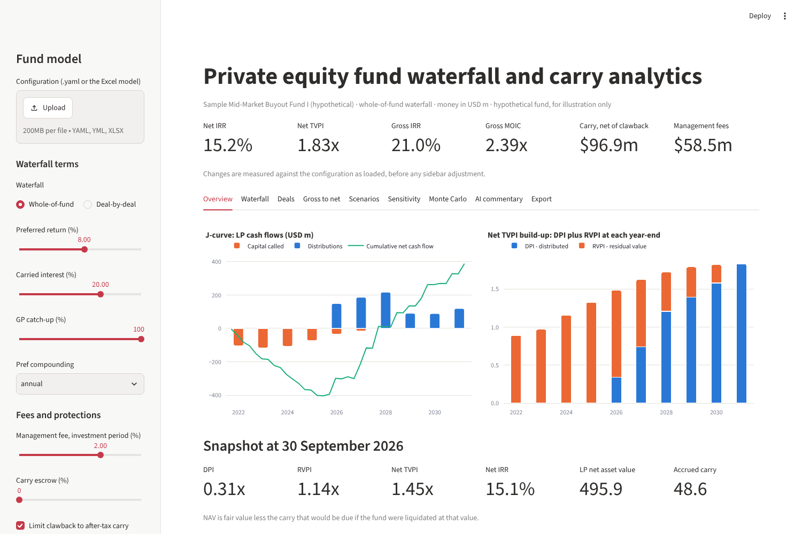

> The fund, its investors and its portfolio companies are hypothetical. This is an analytical
> illustration, not investment, legal or tax advice.

## Contents

- [What it covers](#what-it-covers)
- [Results on the sample fund](#results-on-the-sample-fund)
- [What the model shows](#what-the-model-shows)
- [Quick start](#quick-start)
- [Command line](#command-line)
- [The Excel model](#the-excel-model)
- [The Gen AI layer](#the-gen-ai-layer)
- [Scenario and sensitivity engine](#scenario-and-sensitivity-engine)
- [Dashboard](#dashboard)
- [Architecture](#architecture)
- [How it is verified](#how-it-is-verified)
- [Limitations](#limitations)
- [Documentation](#documentation)

## What it covers

| Area | What is modelled |
| --- | --- |
| **Commitments and calls** | LP and GP commitments, just-in-time capital calls, unfunded commitment, recycling with a cap, a subscription line, fees paid from proceeds once commitments run out |
| **Management fee** | Rate and basis by period (committed, net invested or NAV), step-down after the investment period, transaction and monitoring fee offsets with carry-forward |
| **Portfolio** | Multiple cheques per deal, partial exits, dividend recaps, write-offs, an operating (EBITDA, multiple, leverage) model per buyout, fair-value marks |
| **Waterfall** | Return of capital, preferred return (annual, quarterly or simple), GP catch-up (full, partial or none), carried-interest split |
| **Whole-of-fund and deal-by-deal** | Both, from one algorithm, including loss carryforward, write-downs treated as realised losses, and allocation of fees and expenses to realised deals |
| **Clawback and escrow** | Two-pronged clawback test at liquidation, after-tax limit, carry escrow, quarterly clawback exposure |
| **Returns** | Gross and net IRR, MOIC, DPI, RVPI, TVPI as of any quarter, J-curve, gross-to-net bridge, PME, per-deal and per-investor results |
| **LP / GP economics** | Who receives the profit: LPs, carry, fees, GP commitment, expenses; timing and present value of carry |
| **Scenarios** | Named scenarios, two-way sensitivity tables, tornado, breakeven solver, Monte Carlo simulation |
| **Gen AI** | Commentary, tier-by-tier explanation of any distribution, question answering, with a numeric grounding check |

## Results on the sample fund

The table below is generated from the model by `scripts/update_readme.py`, and a test fails if it is
out of date.

<!-- results:start -->
**Sample Mid-Market Buyout Fund I (hypothetical)** - 500.0 of commitments, 12 deals, money in USD m.

| Base case, at liquidation | Result |
| --- | ---: |
| Gross IRR / gross MOIC (deal level) | 21.0% / 2.39x |
| Net IRR / net TVPI (to LPs) | 15.2% / 1.83x |
| Gross-to-net spread | 575 bps |
| of which fees / expenses / carry | 307 / 51 / 218 bps |
| LP capital paid in / distributed | 466.1 / 853.7 |
| Management fees, net of offsets | 58.5 |
| Carried interest, net of clawback | 96.9 |
| GP and manager share of gross profit | 29.5% |

**Same deals, two waterfalls**

| Waterfall | Net IRR | Net TVPI | Carry paid | Clawback | First carry | Average carry timing |
| --- | ---: | ---: | ---: | ---: | ---: | ---: |
| Whole-of-fund (European) | 15.2% | 1.83x | 96.9 | 0.0 | Dec 2029 | year 8.3 |
| Deal-by-deal (American) | 14.5% | 1.83x | 96.9 | 0.0 | Mar 2026 | year 6.6 |

**Scenarios**

| Scenario | Waterfall | Gross MOIC | Net IRR | Net TVPI | Carry paid | Clawback | Carry kept |
| --- | --- | ---: | ---: | ---: | ---: | ---: | ---: |
| Base case | whole-of-fund | 2.39x | 15.2% | 1.83x | 96.9 | 0.0 | 96.9 |
| Upside | whole-of-fund | 2.76x | 21.3% | 2.09x | 126.5 | 0.0 | 126.5 |
| Downside | whole-of-fund | 1.86x | 8.0% | 1.49x | 32.4 | 0.0 | 32.4 |
| Severe downside | whole-of-fund | 1.32x | 1.6% | 1.10x | 0.0 | 0.0 | 0.0 |
| Delayed exits | whole-of-fund | 2.86x | 14.0% | 2.10x | 131.3 | 0.0 | 131.3 |
| Deal-by-deal waterfall | deal-by-deal | 2.39x | 14.5% | 1.83x | 96.9 | 0.0 | 96.9 |
| Late losses, deal-by-deal | deal-by-deal | 1.42x | 4.4% | 1.18x | 29.2 | 17.5 | 11.7 |
| Late losses, whole-of-fund | whole-of-fund | 1.42x | 5.1% | 1.21x | 0.0 | 0.0 | 0.0 |
| LP-friendly terms | whole-of-fund | 2.39x | 17.1% | 1.99x | 54.4 | 0.0 | 54.4 |
| GP-friendly terms | deal-by-deal | 2.39x | 13.0% | 1.69x | 112.9 | 0.0 | 112.9 |
| Subscription line | whole-of-fund | 2.39x | 16.5% | 1.78x | 94.0 | 0.0 | 94.0 |

*Figures are rounded separately, so components may not add exactly to totals.*
<!-- results:end -->

## What the model shows

**1. Deal-by-deal pays the GP the same carry, 1.7 years sooner.** On identical deals the two
waterfalls end with the same carry. Under deal-by-deal the first carry arrives in March 2026 instead
of December 2029, which costs LPs 68 bps of net IRR and adds 8.3 to the present value of the GP's
carry.

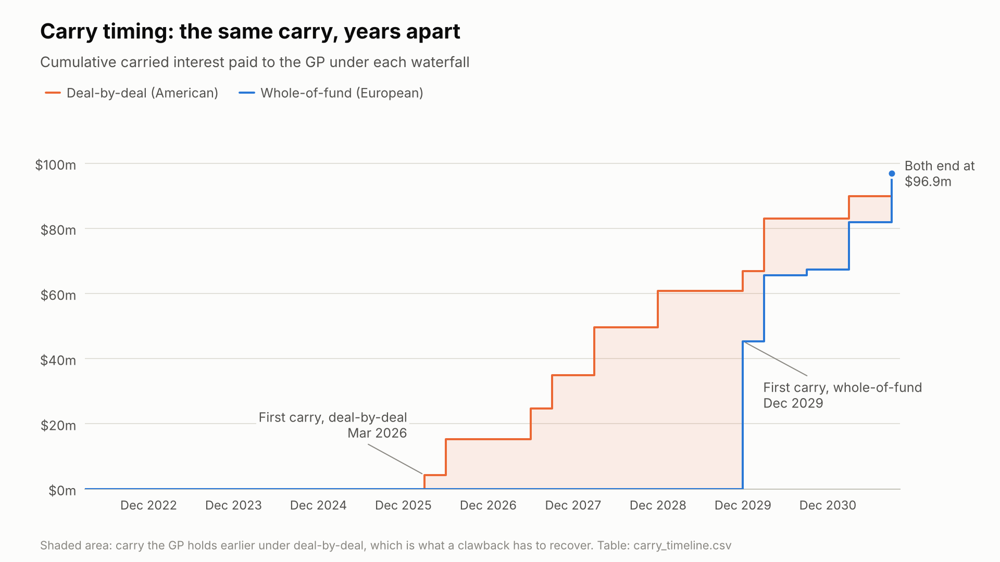

**2. When exits come late and bad, the clawback does not make LPs whole.** In the "late losses"
scenario, deal-by-deal pays 29.2 of carry on early winners. Later losses mean none of it was earned.
The after-tax limit caps the clawback at 17.5, so the GP keeps 11.7 and LPs bear it. Whole-of-fund
pays no carry on the same outcomes.

**3. With a full catch-up, the preferred return decides *when* carry is paid, not *how much*.**
Moving the hurdle from 6% to 10% changes net IRR by 6 bps. Removing the catch-up changes it by
73 bps. The exception is a fund that finishes inside the catch-up zone: in the downside scenario LPs
earn exactly 8.0%, and every dollar above that goes to the GP until it has caught up.

**4. A subscription line raises IRR and lowers the multiple.** Calling capital two quarters later
lifts net IRR from 15.2% to 16.5%, while interest takes net TVPI from 1.83x to 1.78x.

| | |
| --- | --- |
| 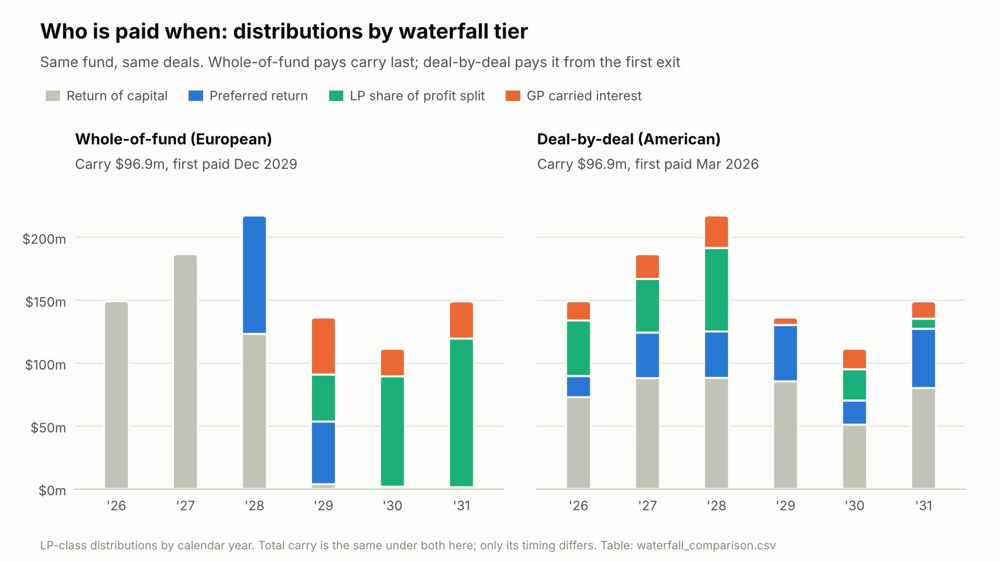 | 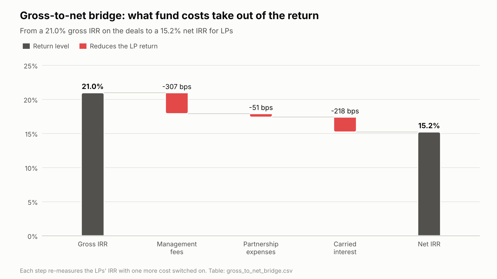 |
| 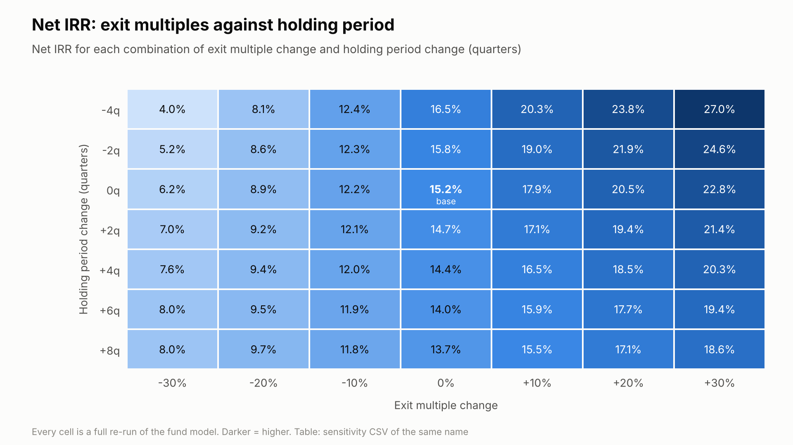 | 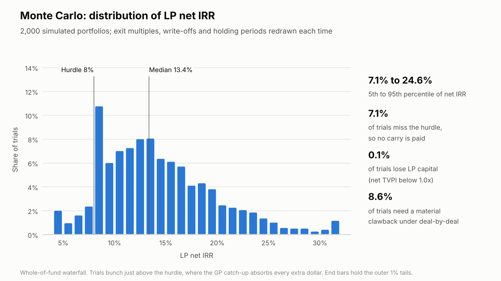 |

## Quick start

Requires Python 3.10 or later.

```bash
# from the repository root
python -m venv .venv
source .venv/bin/activate            # Windows: .venv\Scripts\activate
pip install -e ".[all]"

pefund run                           # headline results for the sample fund
pefund compare                       # whole-of-fund against deal-by-deal
pefund all                           # every table, chart, the Excel model and the commentary
streamlit run app/streamlit_app.py   # interactive dashboard
pytest                               # the test suite
```

`pefund all` writes CSV tables, a JSON summary and charts to [`outputs/`](outputs), and the Excel
model to [`excel/`](excel). Both are committed, so the results can be read without running anything.

To model a different fund, copy [`configs/base_case.yaml`](configs/base_case.yaml), edit it, and
pass it with `--config`. Any assumption can also be overridden for one run:

```bash
pefund run --set waterfall.type=american --set waterfall.carry_rate=0.25
```

## Command line

| Command | What it does |
| --- | --- |
| `pefund run` | Headline returns, waterfall tiers, GP economics, valuation-date snapshot |
| `pefund compare` | The same deals under both waterfalls: carry timing, LP IRR, clawback |
| `pefund scenarios` | Every scenario in [`configs/scenarios.yaml`](configs/scenarios.yaml), with changes from the base case |
| `pefund sensitivity` | Two-way tables, tornado and breakevens |
| `pefund montecarlo` | Simulated distribution of returns, carry and clawback |
| `pefund explain --date 2029-12-31` | One quarter's distribution, tier by tier |
| `pefund commentary` | Grounded investment commentary |
| `pefund ask "..."` | A question about the fund, answered from the model output |
| `pefund excel` | Build the Excel model |
| `pefund verify-excel <workbook>` | Recalculate a workbook with LibreOffice and read its `Checks` sheet |
| `pefund all` | Everything above, written to disk |

```text
$ pefund explain
Quarter ending 31 December 2029 (whole-of-fund waterfall): $93.28m was available to the LP class.
1. Return of capital: $1.73m to LPs. All eligible capital has now been returned.
2. Preferred return: $8.74m to LPs. The preferred return is paid up to date.
3. GP catch-up: $36.01m to the GP, moving the GP towards 20% of profit distributed to date.
4. Residual split: $37.43m to LPs and $9.36m to the GP (80% / 20%).
Result: LPs received $47.91m and the GP $45.37m of carried interest.
```

## The Excel model

[`excel/PE_Fund_Waterfall_Model.xlsx`](excel/PE_Fund_Waterfall_Model.xlsx) has 19 sheets and about
4,100 live formulas. Both waterfalls, the escrow, the clawback test, the returns and the dashboard
are formulas, not pasted values.

- **Nine live levers** (waterfall type, preferred return, compounding, catch-up, carry, clawback
  terms, escrow) recalculate the workbook without Python.
- **A `Checks` sheet** compares 35 totals computed by Excel formulas with the Python engine's
  values. They agree to within 0.000001.
- **It is also an input file.** Edit the blue cells, save, and `pefund excel --config <workbook>`
  rebuilds everything from it.

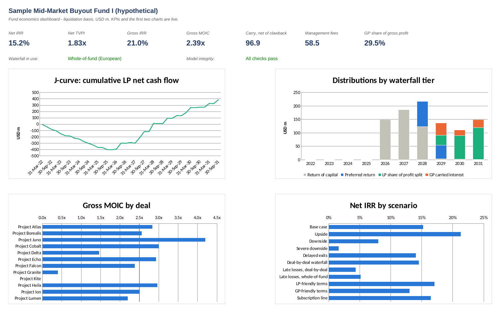

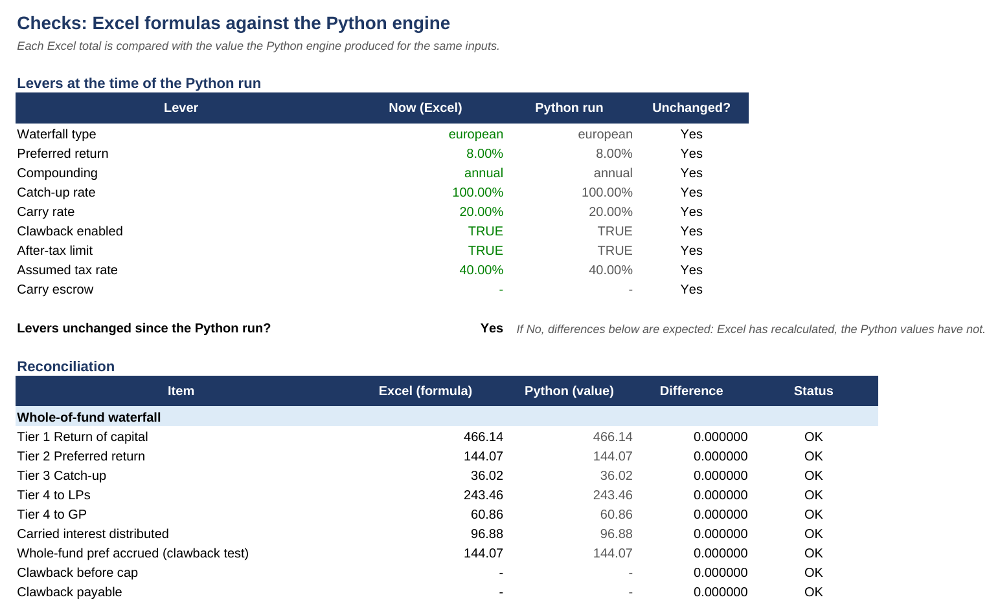

*Sheets rendered with LibreOffice.* More in [docs/excel_model.md](docs/excel_model.md).

## The Gen AI layer

A language model is good at writing and unreliable with numbers. The layer is built around that:

1. The engine condenses its results into a **fact pack** of about 500 figures, already rounded.
2. The model writes commentary **from the fact pack only**. It does no arithmetic.
3. A **grounding check** extracts every number and date from the draft and matches each to the fact
   pack, by value and by kind. A figure called "net IRR" must be a net IRR.
4. Unverified figures are sent back once for repair. If the redraft still fails, the model's text is
   discarded and a deterministic writer's text is used.

```text
Numeric grounding: 170 of 170 figures verified against the model output (100%).
```

It works with Claude (`ANTHROPIC_API_KEY`), with any OpenAI-compatible endpoint, or with no model at
all: the deterministic writer is the default, so the project runs end to end without an API key.
The committed [sample commentary](outputs/ai_commentary.md) was produced by the deterministic
writer. The language-model path is covered by tests that use stand-in clients; it has not been run
against a live API in this repository.

An extract from the sample commentary:

> Under whole-of-fund terms nothing reaches the GP until LPs have received all contributed capital
> plus the preferred return on it. That is why the first carry was paid only in December 2029, 7.8
> years into the fund's life, even though distributions began earlier.

More in [docs/ai_layer.md](docs/ai_layer.md).

## Scenario and sensitivity engine

Every result is a full re-run of the fund; nothing is interpolated.

```python
from pefund import load_config, run_fund
from pefund.scenarios import sensitivity_grid, solve_for

cfg = load_config("configs/base_case.yaml")

# One scenario: exits 15% lower and a year late, under deal-by-deal
downside = cfg.with_values(
    {
        "shocks.exit_multiple_pct": -0.15,
        "shocks.hold_shift_quarters": 4,
        "waterfall.type": "american",
    }
)
print(run_fund(downside).summary["net_irr"])

# A two-way table: carry rate against preferred return
print(sensitivity_grid(cfg, ("carry_rate", [0.15, 0.20, 0.25]), ("pref_rate", [0.06, 0.08, 0.10]), "net_irr"))

# How far can exit valuations fall before LPs miss the 8% hurdle?
print(solve_for(cfg, "exit_multiple", "net_irr", 0.08, low=-0.9, high=0.0))
```

| | |
| --- | --- |
| 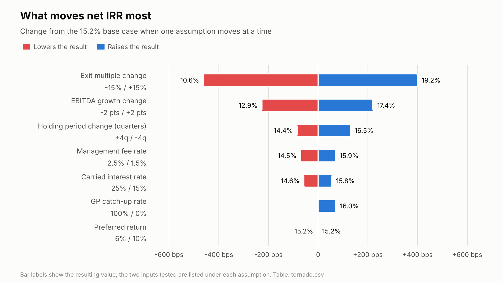 | 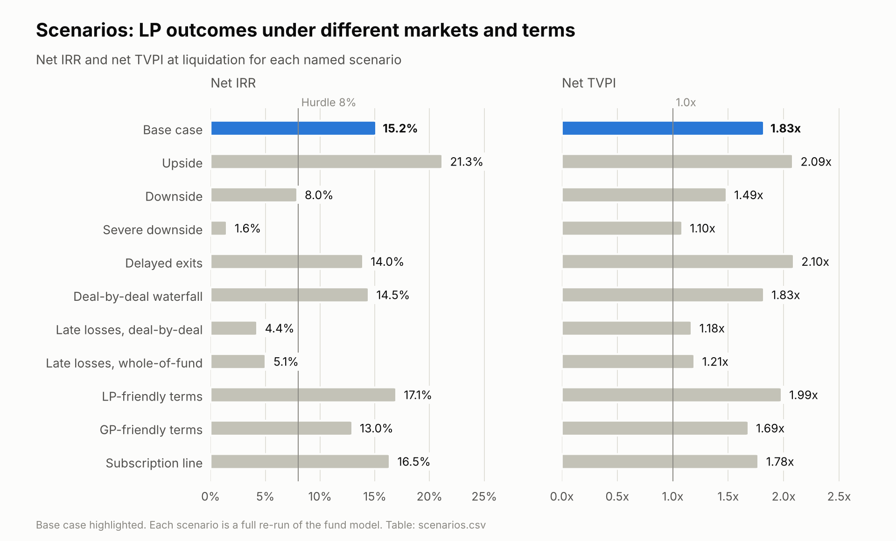 |

On the sample fund, exit valuations can fall 25.8% before LPs miss the hurdle and 43.0% before they
lose capital. In 2,000 simulated outcomes the median net IRR is 13.4% (5th to 95th percentile: 7.1%
to 24.6%), and deal-by-deal ends in a material clawback in 8.6% of them.

## Dashboard

`streamlit run app/streamlit_app.py` opens an interactive version: change the terms or the market
assumptions in the sidebar, upload a configuration or the Excel model, and every tab recalculates.

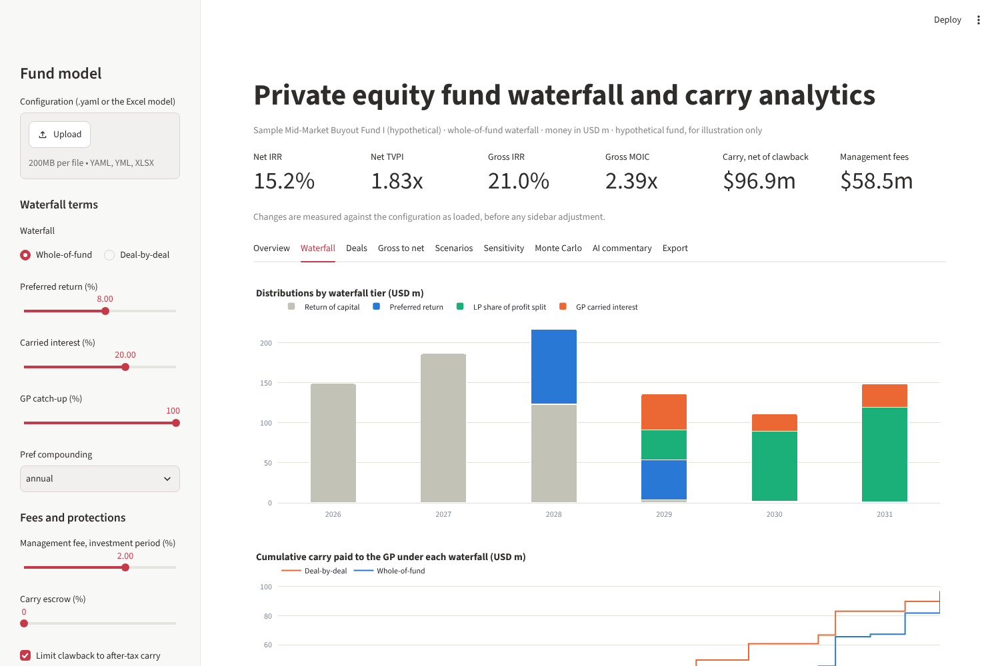

## Architecture

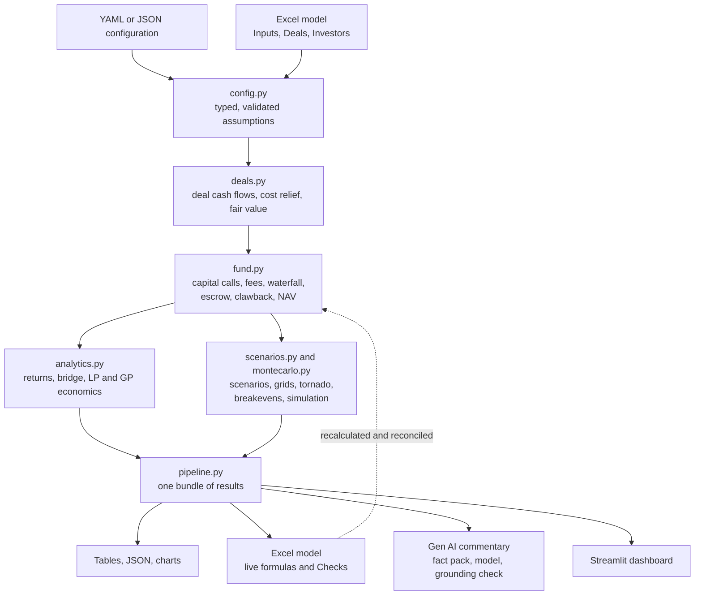

Every surface reads the same bundle, so the command line, the workbook, the commentary and the
dashboard cannot report different numbers.

```text
src/pefund/
  config.py        assumptions as validated dataclasses; YAML, JSON and Excel loaders
  timeline.py      quarter grid and day counts
  deals.py         deal-level cash flows, operating model, fair value
  fund.py          the engine: calls, fees, waterfall, escrow, clawback, interim NAV
  metrics.py       IRR, multiples, PME
  analytics.py     gross-to-net bridge, value split, waterfall comparison, investor accounts
  scenarios.py     scenarios, sensitivity tables, tornado, breakeven solver
  montecarlo.py    simulation
  pipeline.py      runs everything, writes tables and charts
  cli.py           the pefund command
  ai/              fact pack, prompts, provider clients, grounding check, deterministic writer
  reporting/       charts, Excel model builder, Excel reader and verifier
app/               Streamlit dashboard
configs/           base case, scenarios, worked examples
docs/              methodology, worked examples, Excel and Gen AI guides, limitations, glossary
tests/             test suite
excel/, outputs/   generated model and results for the sample fund
```

## How it is verified

A waterfall model that is wrong by a rounding error is wrong. Correctness is established in six
independent ways:

| Check | What it shows |
| --- | --- |
| **Hand-worked cases** | Single-deal waterfalls with every term variant match closed-form answers. See [docs/worked_example.md](docs/worked_example.md) |
| **A second implementation** | A textbook running-ledger waterfall and per-deal ledgers, written separately inside the tests, agree with the engine |
| **Conservation** | Every dollar of proceeds is distributed exactly once, under 14 combinations of features |
| **Excel against Python** | Excel formulas reproduce both waterfalls, including after the levers are changed and in a clawback scenario |
| **Grounding** | Every figure in the generated commentary traces to the model output |
| **This README** | The results table above is regenerated from the model by a test |

The suite has 260 tests and 97% line coverage. It passes on Python 3.10 with the oldest declared
version of every dependency and on Python 3.13 with current versions. The included GitHub Actions
workflow runs lint and tests on both Python versions.

```bash
pytest --cov=pefund      # tests
ruff check . && ruff format --check .
pefund verify-excel excel/PE_Fund_Waterfall_Model.xlsx
```

## Limitations

- A real waterfall is governed by its limited partnership agreement. The engine implements the
  common form of each term; day counts, the definition of realised capital and the clawback
  mechanics vary between funds.
- Cash flows are quarterly, there is one class of LP, and fair value follows a smooth path. There
  are no side letters, later closings, taxes or currencies.
- Monte Carlo volatilities are illustrative, not calibrated.
- The language-model path has not been run against a live API here, and the Excel model has been
  verified in LibreOffice, not in Microsoft Excel.

The full list is in [docs/assumptions_and_limitations.md](docs/assumptions_and_limitations.md).

## Documentation

| Document | Contents |
| --- | --- |
| [Methodology](docs/methodology.md) | Every rule the engine applies, with formulas |
| [Worked examples](docs/worked_example.md) | Two small funds checked by hand, including a clawback |
| [Excel model](docs/excel_model.md) | Sheets, levers, formulas, round trip |
| [Gen AI layer](docs/ai_layer.md) | Fact pack, grounding check, providers, what is and is not tested |
| [Assumptions and limitations](docs/assumptions_and_limitations.md) | What the model simplifies and leaves out |
| [Glossary](docs/glossary.md) | Fund terms as used here |

Further reading on fund terms: the [ILPA Model Limited Partnership Agreement](https://ilpa.org/model-lpa/),
published in whole-of-fund and deal-by-deal versions, and the ILPA Principles, which recommend the
whole-of-fund waterfall.

## Tech stack

Python (NumPy, pandas), openpyxl, Matplotlib, Plotly, Streamlit, Anthropic and OpenAI SDKs, pytest,
ruff, GitHub Actions.

## Licence

[MIT](LICENSE). Copyright 2026 Tanmay Kumar.
# PE-Fund-Waterfall-Carry-Analytics
