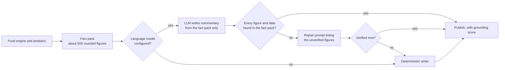

# The Gen AI analytics layer

The Gen AI layer turns model output into the commentary an analyst would write for an investment
committee: what the waterfall did, what drove returns, how gross becomes net, what changes under the
other waterfall, and which scenarios matter.

It is built around one constraint. **In a fund report, a fluent sentence with an invented number is
worse than no sentence.** So the language model never calculates anything, never sees anything but
figures the engine produced, and nothing it writes is published until every figure in it has been
traced back to the model.

## Pipeline



| Step | Module | What it does |
| --- | --- | --- |
| 1. Fact pack | [`ai/facts.py`](../src/pefund/ai/facts.py) | Collects everything worth saying into one JSON document: terms, returns at liquidation and at the valuation date, waterfall tiers, the distribution events, costs, the gross-to-net bridge, the split of profit, each deal, concentration, the waterfall comparison, scenarios, sensitivities, breakevens and the Monte Carlo summary. Figures are **rounded once, here**, to the precision they should be quoted at. |
| 2. Prompt | [`ai/prompts.py`](../src/pefund/ai/prompts.py) | A system prompt that fixes the role, restricts the model to the fact pack, and tells it that text inside the fact pack is data, not instructions. A user prompt that fixes seven section headings. |
| 3. Generation | [`ai/llm.py`](../src/pefund/ai/llm.py) | A thin, provider-neutral client. |
| 4. Grounding check | [`ai/guardrails.py`](../src/pefund/ai/guardrails.py) | Extracts every number and date from the draft and matches each to the fact pack. |
| 5. Repair, then fallback | [`ai/commentary.py`](../src/pefund/ai/commentary.py) | Unverified figures go back to the model once with the offending sentences quoted. If the redraft still fails, the model's text is discarded and the deterministic writer's is used, with a note saying so. |
| Offline writer | [`ai/narrator.py`](../src/pefund/ai/narrator.py) | A rule-based writer that produces the same seven sections from the same fact pack, with no model and no network. |

## The grounding check

`verify_numbers(text, fact_pack)` returns a `GroundingReport`: how many figures were found, how many
were verified, and each unverified figure with its surrounding words.

- **Every figure is checked**, including percentages, multiples, basis points, money, years, counts
  and dates ("December 2029", "Q4 2029", "2029-12-31").
- **Kind must match.** "15.2%" is only verified by a percentage fact. A money fact of 15.2 does not
  count. Keys in the fact pack carry their kind: `_pct`, `_bps`, `_x`, `_years`; everything else is
  money.
- **Labels must match.** A figure introduced as net IRR, gross IRR, TVPI, MOIC, DPI or RVPI must
  equal a fact of that same metric, so a gross IRR cannot be presented as a net IRR.
- **Rounding is allowed only as far as the text itself rounds.** "15%" can match 15.2%; "15.7%"
  cannot.
- **Units convert.** A change quoted in percentage points can match a fact held in basis points, and
  a duration in quarters or months can match one held in years.
- **0, 1 and 100 need no source.**

The report's one-line summary is printed with every commentary, for example
`170 of 170 figures verified against the model output (100%)`.

### What the check does not prove

The check removes invented and mislabelled numbers. It cannot confirm that a correct figure is
attached to the right deal or scenario, and it does not judge reasoning. "Fees take 307 bps" passes
whether or not the sentence around it is sensible. A number written with no unit at all ("12
investments", "a gain of 96.0") is matched against facts of any kind, because its unit is in the
surrounding words. That is why the prompt also restricts the model
to the fact pack, why the scores are reported rather than hidden, and why the commentary is a draft
for an analyst to read, not a substitute for one.

## Providers

| Provider | How it is selected | Notes |
| --- | --- | --- |
| `anthropic` | `ANTHROPIC_API_KEY` is set | Uses the official `anthropic` SDK. Default model `claude-sonnet-5-5`; override with `--model` or `PEFUND_LLM_MODEL`. |
| `openai` | `OPENAI_API_KEY` or `OPENAI_BASE_URL` is set | Uses the `openai` SDK against any OpenAI-compatible endpoint (OpenAI, Azure OpenAI, Ollama, vLLM). The model name must be given. |
| `offline` | No key set, or `--provider offline` | The deterministic writer. This is the default, so the project runs end to end with no account and no cost. |

`PEFUND_LLM_PROVIDER` forces a choice. Keys are read from the environment only; see
[`.env.example`](../.env.example). The fact pack contains no personal data, only the figures of the
fund being modelled, and that is all that is sent to a provider.

## Using it

```bash
pefund commentary                          # full commentary; offline unless a key is set
pefund commentary --provider anthropic     # with Claude
pefund commentary --provider openai --model <model-name>   # any OpenAI-compatible endpoint
pefund explain --date 2029-12-31           # walk through one quarter's distribution, tier by tier
pefund ask "Why does deal-by-deal pay carry earlier?"
```

In Python:

```python
from pefund import load_config
from pefund.pipeline import build_bundle
from pefund.ai.commentary import generate_commentary

bundle = build_bundle(load_config("configs/base_case.yaml"))
result = generate_commentary(bundle)  # provider detected from the environment
print(result.to_markdown())
print(result.grounding.summary(), result.used_fallback)
```

The commentary is also written to `outputs/ai_commentary.md`, placed on the `AI_Commentary` sheet of
the Excel model, and shown in the dashboard.

## What each section covers

1. **Executive summary** – net and gross returns, what the GP earns, where the fund stands at the
   valuation date.
2. **How the waterfall distributed cash** – the amount in each tier and why carry started when it
   did.
3. **What drove returns** – which deals and which value-creation drivers, how concentrated the gain
   is, what the losers cost.
4. **Gross-to-net and LP / GP economics** – the bridge and the split of gross profit.
5. **Whole-of-fund versus deal-by-deal** – timing of carry, LP IRR, clawback exposure.
6. **Scenarios and sensitivities** – the scenarios that matter, the assumptions that move the result,
   the breakevens.
7. **Risks and watch-points** – specific, evidence-based points.

## What has and has not been tested

- **Tested** ([`tests/test_ai.py`](../tests/test_ai.py)): the fact pack; the grounding check,
  including figures of the wrong kind, mislabelled metrics, invented numbers and dates; the
  repair-then-fallback logic, driven by scripted stand-in clients that return good, bad and
  failing responses; the offline writer on the base case, on a loss-making fund, on a fund with no
  preferred return and on a clawback scenario, each of which must pass its own grounding check.
- **Not tested here: a live model call.** The committed sample commentary was produced by the
  deterministic writer. The Anthropic and OpenAI clients are thin wrappers over the official SDKs
  and are exercised only against stand-ins, so the first run with a real key is the first end-to-end
  test of that path. If a provider call fails for any reason, the pipeline reports it and falls back
  to the deterministic writer.
- **Offline `ask` is a keyword lookup** over the fact pack, not language understanding. It returns
  the matching figures. Free-form questions need a provider.
